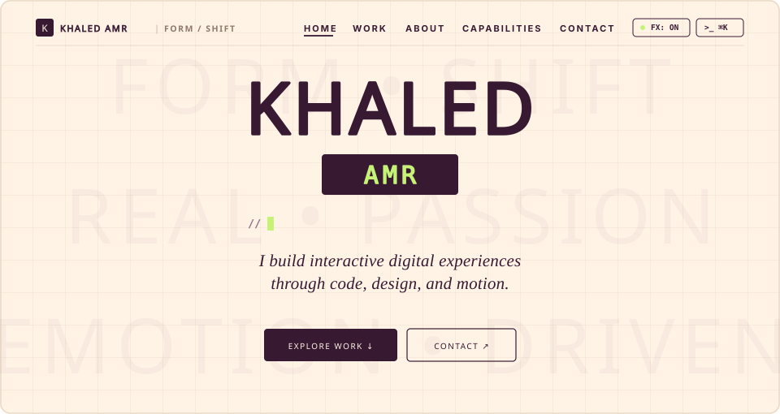

<div align="center">

  

  <br><br>

  <p align="center">
    <a href="https://www.linkedin.com/in/kh%E1%A5%B2%E1%A5%A3%E1%A5%B1d-amr-263334343/">LinkedIn</a>
    &nbsp;&nbsp;&bull;&nbsp;&nbsp;
    <a href="mailto:kaledamr457@gmail.com">Direct Dispatch</a>
    &nbsp;&nbsp;&bull;&nbsp;&nbsp;
    <a href="#selected-engineering-systems">Selected Systems</a>
    &nbsp;&nbsp;&bull;&nbsp;&nbsp;
    <a href="#architectural-competencies">Architectural Competencies</a>
    &nbsp;&nbsp;&bull;&nbsp;&nbsp;
    <a href="#system-telemetry--verification">Telemetry</a>
  </p>

</div>

---

<table width="100%" border="0" cellpadding="8" cellspacing="0">
  <tr>
    <td width="58%" valign="top">
      <h3>Executive Summary</h3>
      <p>
        Software engineer focused on high-performance frontend engineering, spatial computing, and real-time 3D web applications. Specialized in executing continuous 60 FPS graphics pipelines on the web through Three.js, React Three Fiber, and custom WebGL shaders, paired with robust, type-safe full-stack backbones.
      </p>
    </td>
    <td width="42%" valign="top">
      <h3>Operational Status</h3>
      <p>
        <strong>Primary Discipline:</strong> Real-Time 3D &amp; Frontend Systems<br>
        <strong>Current Focus:</strong> SpaceEdu Simulation Architecture<br>
        <strong>Runtime Stack:</strong> TypeScript &bull; React &bull; R3F &bull; PostgreSQL<br>
        <strong>Location:</strong> Cairo, Egypt [UTC+2]
      </p>
    </td>
  </tr>
</table>

---

## Selected Engineering Systems

<details open>
<summary><strong>01 / SpaceEdu &mdash; Real-Time Celestial Simulation Platform &amp; AI Copilot</strong></summary>
<br>

An interactive 3D astrophysics simulation environment engineered to render large-scale astronomical systems natively in the browser at a persistent 60 frames per second.

```
+---------------------+      Draw Call Batching      +-----------------------------+
| Viewport Controller | ---------------------------> | React Three Fiber Scene     |
+---------------------+                              +-----------------------------+
           |                                                        |
           v                                                        v
+---------------------+       Context-Aware Streams  +-----------------------------+
| Keplerian Physics   | <--------------------------- | ARIA AI Autonomous Guidance |
+---------------------+                              +-----------------------------+
```

### Architectural Decisions &amp; Engineering Highlights
- **Instanced Geometry Pipeline:** Replaced individual mesh render passes with instanced buffer geometry for asteroid belts and stellar dust, shrinking GPU draw calls from ~1,200 to under 10 passes per frame.
- **Custom Shading Models:** Implemented GLSL vertex and fragment shaders for planetary atmospheric Rayleigh scattering, dynamic solar corona emissions, and planetary axial light falloff.
- **Physics Engine Integration:** Real-time n-body and Keplerian orbit calculations executing in dedicated animation frames, maintaining mathematical stability across orbital trajectories.
- **Autonomous AI Copilot (ARIA):** Integrated context-aware conversational AI streamed to a customized heads-up display (HUD), dynamically resolving user astrophysics queries based on the active viewport coordinates.

**Technology Stack:** Three.js, React Three Fiber (R3F), @react-three/drei, GLSL, TypeScript, Vite, Tailwind CSS, LLM Streaming API.

</details>

<br>

<details>
<summary><strong>02 / King-Store &mdash; High-Throughput E-Commerce Platform &amp; Administration Suite</strong></summary>
<br>

A full-stack, enterprise-grade storefront designed for international distribution, sub-second page rendering, and real-time inventory telemetry.

### Architectural Decisions &amp; Engineering Highlights
- **Internationalization (i18n) Engine:** Dynamic layout mirroring and locale switching supporting right-to-left (RTL) and left-to-right (LTR) typography with zero layout recalculation overhead.
- **Optimistic State Pipeline:** Decoupled cart and checkout state logic ensuring zero unnecessary component re-renders across deep product trees and sub-second transaction states.
- **Administrative Telemetry Dashboard:** Real-time operational console for catalog CRUD, order lifecycle monitoring, dynamic inventory synchronization, and sales velocity metrics.

**Technology Stack:** React, TypeScript, Tailwind CSS, Modular State Architecture, RESTful API Gateway.

</details>

<br>

<details>
<summary><strong>03 / Warehouse Management System &mdash; High-Reliability LAN Architecture</strong></summary>
<br>

A low-latency inventory management architecture engineered for high concurrency across local area networks (LAN) within industrial logistics operations.

### Architectural Decisions &amp; Engineering Highlights
- **Transactional Consistency:** ACID-compliant PostgreSQL schema with row-level locking routines, eliminating race conditions during concurrent barcode scans across multi-station terminals.
- **Network Resilience:** Structured to sustain zero data loss in intermittent LAN connectivity conditions with automated reconciliation protocols.
- **Access Control &amp; Audit Logs:** Role-based access control (RBAC) separating station operators, dispatch coordinators, and system administrators with tamper-evident audit trails.

**Technology Stack:** Node.js, Express, PostgreSQL, REST APIs, LAN Topology Optimization, Connection Pooling.

</details>

---

## Architectural Competencies

| Domain | Core Stack | Implementation Discipline |
| :--- | :--- | :--- |
| **Real-Time 3D &amp; Graphics** | Three.js, React Three Fiber, GLSL, WebGL | Buffer geometry instancing, procedural shaders, camera rigs, 60 FPS enforcement |
| **Frontend Architecture** | React 18+, TypeScript, Next.js, Vite | Immutable state patterns, frame budget enforcement, strict typing, modular hooks |
| **Interface Systems** | Tailwind CSS, Framer Motion, Figma | High-contrast dark interfaces, tactile micro-interactions, responsive typography |
| **Backend &amp; Persistence** | Node.js, Express, PostgreSQL, REST | ACID transaction pipelines, query optimization, connection pooling, RBAC |
| **Engineering Workflow** | Git, Docker, Bash, Linux / Unix | Deterministic build pipelines, semantic versioning, containerization, linting |

---

## System Telemetry &amp; Verification

```
$ curl -s https://api.github.com/users/Lander2007 | jq '{login, public_repos, company, location}'
{
  "login": "Lander2007",
  "name": "Khaled Amr",
  "specialization": "Frontend & Real-Time 3D Web",
  "location": "Cairo, Egypt",
  "availability": "Open for full-time and contractual engineering mandates"
}
```

---

## Direct Communication Channels

| Protocol | Address / Destination | Focus |
| :--- | :--- | :--- |
| **Electronic Mail** | [kaledamr457@gmail.com](mailto:kaledamr457@gmail.com) | Contractual mandates, technical proposals, direct hiring |
| **LinkedIn Network** | [Khaled Amr](https://www.linkedin.com/in/kh%E1%A5%B2%E1%A5%A3%E1%A5%B1d-amr-263334343/) | Professional profile, credentials, and verification |
| **Version Control** | [@Lander2007](https://github.com/Lander2007) | Public repositories, architecture patterns, and commits |

<br>

<div align="center">
  <sub>Khaled Amr &bull; Software Engineer &bull; Cairo, Egypt &bull; All Systems Nominal</sub>
</div>
